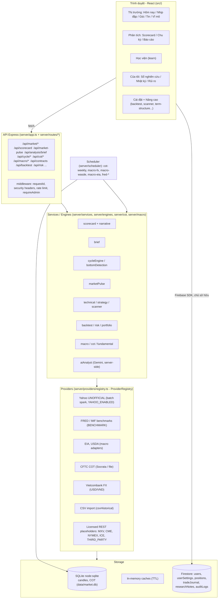

# Kiến trúc hệ thống - COMMODITY TRADING AI PRO

> **English summary.** A research-only commodity-derivatives terminal. React SPA (Vite) -> Express API (`server/app.ts`)
> -> services/engines -> `ProviderRegistry` (fail-closed, honest quality labels) -> storage (SQLite candles/COT,
> in-memory caches, Firestore for per-user data). Prices always carry a status (`CURRENT/DELAYED/HISTORICAL/STALE/
> UNAVAILABLE/INVALID`) and a source tier (`OFFICIAL/LICENSED_VENDOR/UNOFFICIAL`). Never invent numbers; never give
> trade advice. This file is the map for the owner and for future agents; keep it in sync with the code.

Tài liệu dành cho chủ dự án (người mới) và các agent sau này. Đường dẫn tính từ thư mục gốc dự án.

---

## 1. Tổng quan hệ thống

Ý tưởng một câu: **trình duyệt hỏi API, API gọi các "engine" tính toán, engine lấy dữ liệu qua "registry nguồn dữ liệu",
registry đọc nguồn ngoài hoặc kho lưu trữ, và luôn gắn nhãn chất lượng trước khi trả về.**



Ghi chú quan trọng:
- Dữ liệu cá nhân (ghi chú, nhật ký, vị thế) đi **thẳng từ trình duyệt tới Firestore** (có `firestore.rules`), không qua Express.
- Dữ liệu giá, COT, vĩ mô đi qua Express; khóa API chỉ nằm ở server.
- `GET /api/architecture` trả danh sách module từ `src/shared/architecture.ts` (tĩnh, có thể lệch so với thực tế).

---

## 2. Luồng dữ liệu giá

Nhãn chất lượng (định nghĩa ở `src/shared/types/market.ts`):

| Loại | Giá trị | Ý nghĩa |
|---|---|---|
| Trạng thái (`DataQualityStatus`) | `CURRENT`, `DELAYED`, `HISTORICAL`, `STALE`, `UNAVAILABLE`, `INVALID` | Độ tươi / hợp lệ của dữ liệu |
| Nguồn (`SourceQualityLabel`) | `OFFICIAL`, `LICENSED_VENDOR`, `UNOFFICIAL` | Mức tin cậy / bản quyền của nguồn |
| Loại (`kind`) | `FUTURES` (mặc định), `BENCHMARK` | `BENCHMARK` = chuỗi tham chiếu (vd IMF qua FRED), **không phải** giá hợp đồng tương lai |

Thứ tự ưu tiên trong `ProviderRegistry.getQuoteForInstrument` (`server/providers/registry.ts`):

1. Nguồn có giấy phép/chính thức (nếu có khóa trên server) và Yahoo UNOFFICIAL ở **cuối** chuỗi live.
   Chỉ nhận quote `CURRENT`/`DELAYED`; quote Yahoo `STALE` (có giá) được giữ làm `staleFallback`.
2. Giá đóng cửa gần nhất từ kho lịch sử (bộ nhớ + SQLite), gắn `HISTORICAL` kèm ngày thanh; thanh mới hơn thắng
   `staleFallback`.
3. Benchmark FRED (vd `DCOILBRENTEU` cho BRN), gắn `BENCHMARK`.
4. Không có gì -> **fail closed**: `UNAVAILABLE`, không bịa số.

```mermaid
sequenceDiagram
  participant UI as UI (React)
  participant API as GET /api/market/quotes
  participant REG as ProviderRegistry
  participant C as Cache (liveQuoteCache, TTL)
  participant Y as Yahoo UNOFFICIAL (batch spark)
  participant H as Kho lịch sử (RAM + SQLite)
  participant F as FRED benchmark
  UI->>API: yêu cầu giá (lọc theo nhóm / sàn)
  API->>REG: getQuoteForInstrument(từng mã)
  REG->>C: còn hạn TTL?
  alt cache còn hạn
    C-->>REG: quote đã gắn nhãn
  else hết hạn
    REG->>Y: lấy giá (có timeout, làm mới nền)
    Y-->>REG: CURRENT/DELAYED hoặc STALE
    REG->>H: giá đóng cửa gần nhất (HISTORICAL)
    REG->>F: benchmark nếu có (BENCHMARK)
  end
  REG-->>API: MarketQuote {status, sourceQuality, kind, retrievedAt}
  API-->>UI: quotes + overallStatus + notice
  Note over UI: DataStatusBadge hiển thị nhãn;<br/>UNAVAILABLE hiện "không có dữ liệu", không điền số
```

`overallStatus` trong `server/app.ts` = CURRENT nếu có quote live; ngược lại DELAYED > HISTORICAL > STALE > UNAVAILABLE.
UI hiển thị nhãn bằng `src/components/common/DataStatusBadge.tsx`.

---

## 3. Bản đồ module

Menu có 4 mục chính (+ Học viện, Cài đặt, Nâng cao) - cấu hình ở `src/components/layout/navMap.ts`,
hiển thị ở `Sidebar.tsx`, điều phối trang ở `src/App.tsx`, các tab ở `src/components/views/hubs/Hubs.tsx`.

| Mục menu | Tab / view | File chính (`src/components/views/`) | API | Service / engine |
|---|---|---|---|---|
| Thị trường | Hôm nay | `today/TodayPanel.tsx` | `/api/market-pulse`, `/api/scorecard` | `services/marketPulse`, `services/scorecard` |
| Thị trường | Nhịp đập | `pulse/MarketPulsePanel.tsx` (+ `tileBits.tsx`, `tileMath.ts`) | `/api/market-pulse` | `services/marketPulse/service.ts` |
| Thị trường | Giá (thẻ/bảng) | `CommodityWorldView.tsx`, `MarketWatchView.tsx` | `/api/market/quotes`, `/api/instruments`, `/api/market/fx/usdvnd` | `providers/registry.ts` |
| Thị trường | Tin tức / Vĩ mô | `today/FundamentalNewsFeed.tsx`, `news/MacroPanel.tsx`, `common/calendarGroups.ts` | `/api/macro/overview\|eia\|wasde\|fx`, `/api/fundamental/records` | `server/macro`, `services/fundamentalService.ts` |
| Phân tích | Scorecard | `scorecard/*` (`shared.tsx`, `scoreMath.ts`) | `/api/scorecard[/:id]`, `POST .../summary` | `services/scorecard/*` (scoring, valuation, narrative) |
| Phân tích | Chu kỳ | `CycleScannerView.tsx` | `/api/cycle/overview\|scanner\|profile\|verdict` | `engines/cycleEngine.ts`, `bottomDetectionEngine.ts`, `services/cycle*Service.ts` |
| Phân tích | Báo cáo | `CycleResearchReportView.tsx` | `/api/cycle/report[/generate]` | `services/cycleResearchService.ts` |
| Mã (instrument) | Tổng quan | `brief/*` | `/api/analysis/brief/:id` | `services/brief/briefService.ts` |
| Mã | Biểu đồ | `ChartsView.tsx`, `charts/*` | `/api/market/candles`, `/api/technical/:symbol` | `engines/technicalEngine.ts` |
| Mã | COT | `cot/*` | `/api/cot/markets\|health\|:id`, `POST /api/cot/sync` | `server/cot/*` |
| Mã | Hồ sơ / AI | `CommodityProfileView.tsx`, `AiAnalystView.tsx` | `POST /api/ai/analyze` | `services/aiAnalyst.ts` |
| Học viện | Bài học, máy tính | `learn/LearnView.tsx`, `LessonPage.tsx`, `Calculators.tsx` | - | - |
| Học viện | Trình dựng bài học | `learn/lesson/*` (`LessonBody`, `KeyPoints`, `LessonQuiz`, `GlossaryTip`, `bodyParse.ts`), `learn/diagrams/groupA-D.tsx` + `Figures.tsx`, `learn/LessonVideos.tsx`, nội dung `learn/curriculum/level1-10.ts` | - | Video: chỉ nhà xuất bản uy tín, kiểm tra oEmbed |
| Học viện | Lộ trình 3 tháng | `src/shared/program/threeMonth.ts` (12 tuần, 3 giai đoạn, lưu `ctap.program.v1`) | - | - |
| Của tôi | Giao dịch giả lập (kỷ luật) | `papertrade/PaperTradingView.tsx`, `coolOff.ts`, `mistakeStats.ts`, `weeklyReview.ts`, `EventRiskBanner.tsx`, `paperFirestore.ts` | `POST /api/paper/weekly-review` | `server/routes/paperReview.ts`, `src/shared/events/eventRisk.ts`, `usMacroCalendar.ts` |
| Của tôi | Sổ nghiên cứu | `journal/ResearchNotebookView.tsx` | Firestore `researchNotes` | - |
| Của tôi | Nhật ký / Rủi ro | `TradeJournalView.tsx`, `RiskManagementView.tsx` | `POST /api/journal/analytics`, `/api/risk/calculate` | `engines/riskEngine.ts` |
| Cài đặt | Cài đặt, Sức khỏe dữ liệu, Nhập dữ liệu | `SettingsView.tsx`, `DataHealthView.tsx`, `common/CsvImportPanel.tsx` | `/api/health`, `/api/providers/health`, `/api/data/health-report`, `POST /api/data/import`, `/api/market/candles/import` | `services/dataHealthService.ts`, `csvImporter.ts`, `server/data/*` |
| Nâng cao | Backtest, Scanner, Tín hiệu, Danh mục, Kỹ thuật, Cấu trúc kỳ hạn, Explorer | `BacktestView`, `ScannerView`, `SignalsView`, `PortfolioView`, `TechnicalAnalysisView`, `termstructure/*`, `ContractExplorerView` | `/api/backtest/run`, `/api/scanner/scan`, `/api/signals/:s`, `/api/portfolio/analyze`, `/api/contracts/*`, `/api/mxv/estimate` | `engines/backtestEngine`, `scannerEngine`, `strategyEngine`, `portfolioEngine`, `services/mxvEstimator.ts` |

### Ánh xạ id module cũ -> hub (navMap.ts)

Các id cũ vẫn dùng cho deep link (vd bài Học viện); `resolveModule()` đổi sang hub + tab.

| id cũ | Hub / tab | id cũ | Hub / tab |
|---|---|---|---|
| `commodity-world` | market-hub / prices (cards) | `brief` | instrument / overview |
| `markets` | market-hub / prices (table) | `charts` | instrument / charts |
| `news` | market-hub / news | `cot` | instrument / cot |
| `fundamental` | market-hub / macro | `commodity-profile` | instrument / profile |
| `scorecard` | analysis-hub / scorecard | `ai-analyst` | instrument / ai |
| `cycle-hunter` | analysis-hub / cycle | `journal` | mine-hub / journal |
| `research-report` | analysis-hub / report | `risk` | mine-hub / risk |

Id không có trong `MAP` rơi vào: `learn` -> Học viện; `settings`, `data-health`, `data-import` -> Cài đặt
(`SETTINGS_ITEMS`); còn lại (`overview`, `backtest`, `term-structure`, `scanner`, `signals`, `portfolio`, `technical`,
`explorer`, `analysis`) -> Nâng cao (`ADVANCED_ITEMS`). Trạng thái điều hướng nằm ở `src/contexts/TerminalContext.tsx`.

Luồng kỷ luật paper trading: lệnh đóng -> `coolOff.ts` (khóa lệnh MỚI 24h theo giờ Việt Nam sau 3 lỗ liên tiếp hoặc lỗ ngày <= -3% vốn; đóng lệnh không bị chặn) -> `mistakeStats.ts` (thẻ lỗi, thống kê tháng) -> `weeklyReview.ts` (review tuần thuần công thức; client có thể gọi `POST /api/paper/weekly-review` để lấy đoạn nhận xét ngắn, lỗi/503 thì giữ bản công thức). `eventRisk.ts` (thuần, không mạng) liệt kê báo cáo tác động cao trong 24h tới cho phiếu lệnh.

Chuỗi model AI (`server/lib/geminiModels.ts`): `GEMINI_MODEL` (hoặc danh sách miễn phí mặc định) -> thử model kế khi 503/429/404/500 -> OpenRouter `:free` nếu có `OPENROUTER_API_KEY`. Dùng chung cho AI Analyst (`aiAnalyst.ts`), `cycleAiService.ts`, `lessonRecommender.ts`, tóm tắt tin (`news/summarizer.ts`) và review tuần (`paperReview.ts`).

Scheduler (`server/scheduler/jobs.ts`): job `cot-weekly`, `macro-fx`, `macro-wasde`, `macro-eia`, `fred-macro`,
`fred-public-macro`. Trạng thái xem `GET /api/scheduler/status`.

---

## 4. Dữ liệu và bảo mật

**Biến môi trường** (danh sách đầy đủ và ý nghĩa: `README.md` mục biến môi trường, và `.env.example`):

| Nhóm | Biến tiêu biểu |
|---|---|
| Server | `PORT`, `HOST`, `NODE_ENV`, `TRUST_PROXY`, `MARKET_DB_PATH` |
| Bảo vệ ghi | `ADMIN_API_TOKEN` |
| AI | `GEMINI_API_KEY`, `GEMINI_MODEL`, `OPENROUTER_API_KEY`, `OPENROUTER_MODEL`, `AI_ANALYST_TIMEOUT_MS` |
| Yahoo | `YAHOO_ENABLED`, `YAHOO_HISTORY_WARMUP` |
| COT | `COT_SOURCE`, `COT_CACHE_DIR`, `CFTC_APP_TOKEN`, `CFTC_*_DATASET_ID` |
| Nguồn có giấy phép / vĩ mô | `EIA_API_KEY`, `USDA_API_KEY`, `MXV_API_URL/KEY`, `CME_DATAMINE_API_KEY`, `ICE_API_KEY`, `TWELVEDATA_API_KEY`, `FMP_API_KEY`... |

Nguyên tắc bảo mật:
- **Bí mật chỉ ở server.** Không đặt khóa vào code `src/`, không dùng tiền tố `VITE_` cho khóa. AI Analyst gọi Gemini ở server.
- **Endpoint ghi được bảo vệ** bằng `requireAdmin` (`server/middleware/adminAuth.ts`, nối dây trong `server/app.ts`):
  `POST /api/data/import`, `/api/cot/sync`, `/api/market/candles/import`, `/api/providers/sync`,
  `/api/providers/yahoo/history`, `/api/fundamental/records`, `DELETE /api/market/candles`.
  Có `ADMIN_API_TOKEN` -> bắt buộc `Authorization: Bearer ...`. Không có -> chỉ nhận request trực tiếp từ localhost
  (request có header proxy bị coi là không phải localhost).
- **Giới hạn tốc độ** `/api` (`middleware/rateLimit.ts`) và giới hạn riêng cho `/api/ai/analyze`; giới hạn kích thước body theo route.
- **Firestore** (`firestore.rules`): mặc định chặn tất cả (`allow read, write: if false`); chỉ mở các collection
  `users`, `userSettings`, `positions`, `tradeJournal`, `researchNotes`, `auditLogs` cho **chủ sở hữu đã xác minh**
  (kiểm tra id hợp lệ, schema). `users` không cho `list`; `auditLogs` chỉ thêm (append-only).
  Kiểm thử: `npm run test:rules` (emulator, `tests/rules/*.emulator.test.ts`). Database Firestore có tên: triển khai luật bằng
  `npx firebase deploy --only firestore` (không dùng `firestore:rules`).
- **Khách không tải Firestore SDK**: `src/firebase.ts` chỉ nạp `firebase/firestore` khi cần qua `getFirestoreModules()` (import động); view lười dùng `src/firestoreDb.ts`.
- `security_spec.md` mô tả thêm mô hình đe dọa.

Lưu trữ: SQLite `data/market.db` (`server/storage/sqliteCandleRepository.ts`, `node:sqlite`) cho nến và COT; cache RAM
có TTL cho quote; `data/cache` cho file COT. Lưu ý: trên host tạm thời (Cloud Run) SQLite mất khi khởi động lại (xem T53).

---

## 5. Nguyên tắc dự án

1. **Không bịa số.** Không có dữ liệu -> `UNAVAILABLE`/"chưa có dữ liệu", không dùng giá trị mẫu, không nội suy ngầm.
2. **Nhãn trung thực.** Mọi con số giá phải đi kèm trạng thái + mức nguồn + thời điểm lấy. Yahoo luôn `UNOFFICIAL`;
   benchmark luôn `BENCHMARK`, không trình bày như giá hợp đồng.
3. **Nghiên cứu, không khuyến nghị.** Văn bản AI/narrative/brief mô tả bằng chứng và rủi ro, không "nên mua/bán"; có
   disclaimer. Mẫu câu nằm trong `templates.ts` của từng service.
4. **CSV là định dạng chuẩn (canonical)** cho dữ liệu lịch sử nhập tay (`docs/DATA_IMPORT.md`,
   `server/data/csvOhlcvParser.ts`); mọi nguồn khác quy về cùng mô hình nến (`MarketCandle`).
5. **Fail closed.** Nguồn chưa cấu hình/không hợp lệ -> báo không khả dụng (`FailClosedProviderAdapter`), không rơi
   về dữ liệu giả. Validate đầu vào bằng zod; lỗi trả JSON có `error` + `message`.
6. Tiếng Việt là mặc định, có bản tiếng Anh; thuật ngữ khó giải thích qua popover `today/InfoTip.tsx` hoặc `<details>`. Quy tắc UI: `docs/UI_GUIDE.md`.

---

## 6. Quy ước mở rộng

### 6.1 Thêm nguồn dữ liệu mới
- [ ] Đọc điều khoản sử dụng; xác định `sourceQuality` đúng (đừng ghi OFFICIAL nếu không phải).
- [ ] Thêm `ProviderId` ở `src/shared/types/market.ts` (nếu là nhà cung cấp mới).
- [ ] Viết adapter trong `server/providers/` (mẫu: `externalAdapters.ts`, `yahooAdapter.ts`, `fredBenchmarks.ts`); khóa đọc từ
  `process.env` ở server; thiếu khóa -> fail closed.
- [ ] Đăng ký trong `ProviderRegistry` (`registry.ts`) và đặt đúng vị trí ưu tiên trong chuỗi quote.
- [ ] Gắn `status`, `sourceQuality`, `retrievedAt` (và `kind: 'BENCHMARK'` nếu là chuỗi tham chiếu); TTL cache hợp lý.
- [ ] Nếu cần lưu: dùng `ICandleRepository` (`server/storage`), mã nhà cung cấp theo `VENDOR_CONTRACT_PREFIX`.
- [ ] Nếu cần định kỳ: thêm job trong `server/scheduler/jobs.ts`.
- [ ] Test với dữ liệu mẫu trong `__fixtures__` (không gọi mạng thật); thêm biến môi trường vào `.env.example` + `README.md`;
  cập nhật `docs/REALTIME_DATA_SOURCES.md`.

### 6.2 Thêm trang / tab mới
- [ ] View đặt trong `src/components/views/<tên>/`; dùng UI kit `src/components/ui/` (`Card`, `Badge`, `Stat`,
  `SectionHeader`, `EmptyState`, `Skeleton`) cho đồng nhất; trang nặng dùng lazy (`lazyWithRetry.tsx`).
- [ ] **i18n**: tạo file từ điển mới trong `src/i18n/dict/<tên>.ts` (vi + en) và đăng ký trong `src/i18n/`
  (xem các file dict hiện có, vd `nav2.ts`, `scorecard.ts`); mọi chuỗi UI dùng `t('khóa')`, không hardcode.
- [ ] Tab trong hub: thêm vào `Hubs.tsx`; id module mới (nếu cần) thêm vào `AppModuleId` (`src/shared/types/risk.ts`) và `navMap.ts`
  (`MAP` hoặc `SETTINGS_ITEMS`/`ADVANCED_ITEMS`).
- [ ] Hiển thị giá/số: luôn kèm `DataStatusBadge`; trạng thái trống dùng `EmptyState`, tải dùng `Skeleton`.
- [ ] Endpoint mới: tạo `server/routes/<tên>.ts` (`registerXRoutes(app, deps)`) rồi gọi trong `server/app.ts`;
  validate bằng zod; endpoint ghi phải qua `requireAdmin`; kiểu dùng chung đặt ở `src/shared/types/`; thêm client trong `src/api/`.

### 6.3 Thêm task cho agent
Mỗi task trong `docs/AUDIT_AND_PLAN.md` nên có:
- **Scope file riêng** (liệt kê file được sửa/tạo; tránh đụng file của task khác chạy song song, đặc biệt `server/app.ts`,
  `Hubs.tsx`, `navMap.ts`, `src/i18n/*`).
- **Không `git commit/push`** (chủ dự án / điều phối viên commit).
- **Tiêu chí xong** đo được (hành vi nhìn thấy được hoặc test).
- Chạy `npm run lint`, `npm test`, `npm run build` (thêm `npm run test:rules` nếu đụng `firestore.rules`) và báo kết quả.
- Giao **tuần tự** nếu task động vào cùng file; báo cáo ngắn: đã làm gì, điều bất nhất phát hiện được.

---

## 7. Kiểm thử và vận hành

| Lệnh | Tác dụng |
|---|---|
| `npm run dev` | Chạy `tsx server.ts` (Express + Vite middleware) |
| `npm run build` | `vite build` -> `dist/` |
| `npm start` | `tsx server.ts --production` (phục vụ `dist/`) |
| `npm run lint` / `typecheck` | `tsc --noEmit` (hiện hai lệnh giống nhau) |
| `npm test` | `tsx --test` cho `server/**/*.test.ts`, `src/**/*.test.ts`, `*.test.ts` ở gốc |
| `npm run test:rules` | Firestore emulator + `tests/rules/*.test.ts` |
| `npm run test:e2e` | Playwright, bộ test `tests/e2e/`: `smoke`, `learning`, `program`, `keyboard`, `features13b`, `discipline` (cool-off, thẻ lỗi, review tuần, rủi ro sự kiện); cấu hình `playwright.config.ts` |

Hỗ trợ a11y form: `src/components/common/fieldErrors.ts` (`fieldErrorProps` gắn `aria-invalid`/`aria-describedby` theo từng trường). Bố cục test: unit test cạnh code (`foo.ts` + `foo.test.ts`), fixture ở `__fixtures__/`, test rules ở `tests/rules/`,
`firestore.rules.test.ts` ở gốc, e2e ở `tests/e2e/`.

CI (`.github/workflows/ci.yml`, Node 24): job `build` = `npm ci` -> typecheck -> test -> build -> Playwright e2e;
job `firestore-rules` = emulator (cần Java 21).

Triển khai: xem `docs/DEPLOY.md` (Dockerfile ở gốc). Tài liệu liên quan: `docs/DATA_IMPORT.md`,
`docs/REALTIME_DATA_SOURCES.md`, `docs/DATA_SOURCES_MISSING.md`, `docs/VN_DERIVATIVES_MARKET.md`, `docs/LEARNING_PATH.md`.
